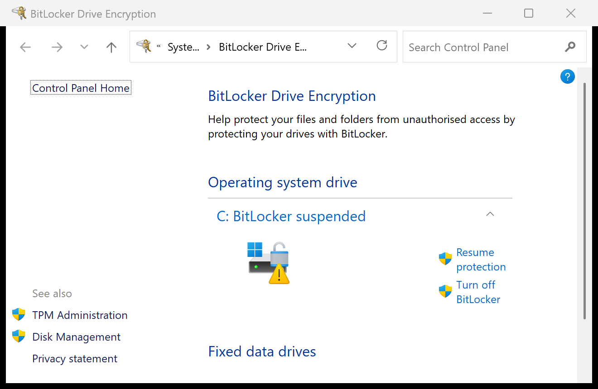
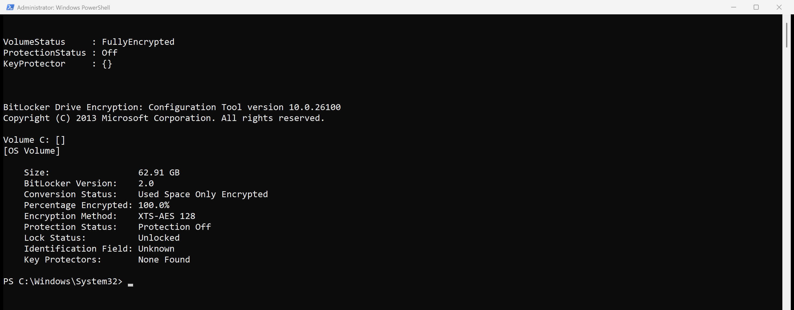
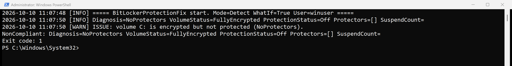
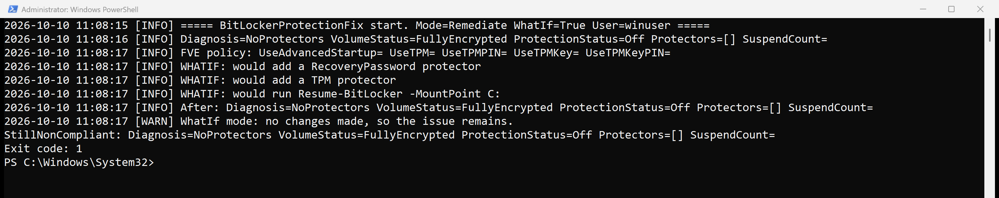
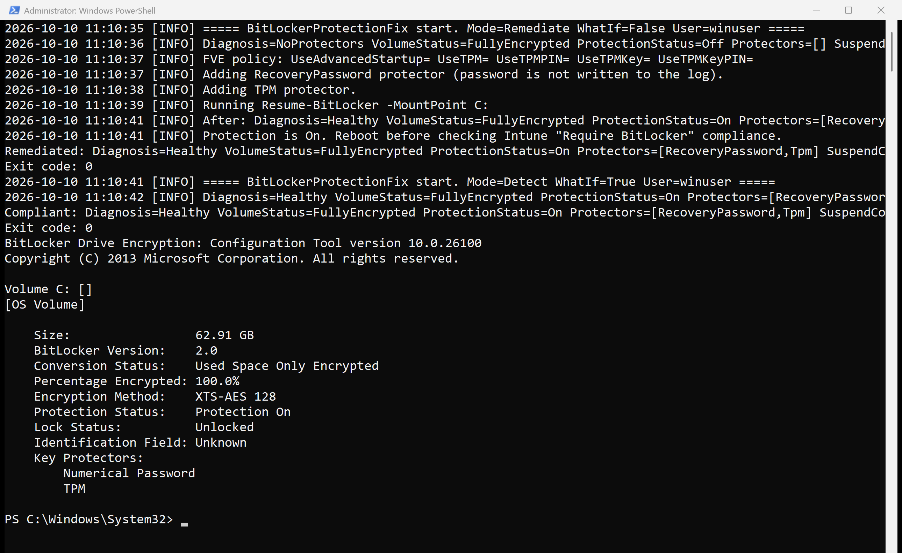
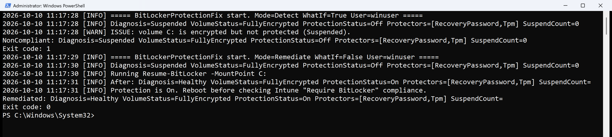

# Atliso BitLocker Protection Fix


Fixes a Windows OS drive that is **fully encrypted but not protected**: the "BitLocker waiting for activation" warning, `Protection Off`, `Key Protectors: None Found`, or a suspension that never resumed.

It never decrypts the drive. It adds the missing TPM protector, or resumes protection, and the clear key is removed.

Full guide: https://atliso.com/blog/bitlocker-waiting-for-activation-protection-off-fix

## What it handles

| State | What you see | What the script does |
|---|---|---|
| NoProtectors | `Key Protectors: None Found`, Protection Off | Adds a recovery password (optional) and a TPM protector, then resumes |
| NoTpmProtector | Recovery password only, Protection Off | Adds a TPM protector, then resumes |
| Suspended | `Protection Off (1 reboots left)` that never clears | Runs `Resume-BitLocker` |
| Healthy / not encrypted / converting | | Does nothing, exits 0 |

Safety checks before any change: TPM present and ready, BitLocker policy allows TPM-only startup (if a startup PIN or key is required it reports and exits 1), and a pending update reboot is respected.

## What it looks like

Tested on Windows 11 25H2 with a TPM. Every screenshot is from a real run of this script.

The broken state. On 25H2, Control Panel labels it "BitLocker suspended"; many devices show "BitLocker waiting for activation". Same problem, same fix:



Fully encrypted, but Protection Off and no key protectors:



Detection finds it and exits 1:



Remediate with the default `$WhatIf = $true` only logs what it would do:



Real remediation, then detection and manage-bde confirming Protection On. The new recovery password is never printed or logged:



A suspension that never resumed (`Suspend-BitLocker -RebootCount 0`) is caught and fixed with a single `Resume-BitLocker`:



## Configuration

Edit the CONFIG block at the top of the script:

```powershell
$Mode                         = 'Detect'          # 'Detect' or 'Remediate'
$WhatIf                       = $true             # $false in the Intune remediation copy
$MountPoint                   = $env:SystemDrive
$AddRecoveryPasswordIfMissing = $true
$BackupToEntra                = $false            # Entra joined devices only
$SkipIfRebootPending          = $true
```

`$WhatIf = $true` is the default, so the first run only logs.

## Deploy as an Intune remediation

Intune admin center: **Devices > Scripts and remediations > Remediations > Create**.

| Setting | Value |
|---|---|
| Detection script | Copy with `$Mode = 'Detect'` |
| Remediation script | Copy with `$Mode = 'Remediate'` and `$WhatIf = $false` (Intune cannot pass parameters) |
| Run this script using the logged-on credentials | No (runs as SYSTEM) |
| Run script in 64-bit PowerShell | Yes |
| Schedule | Daily |

## Exit codes

| Mode | 0 | 1 |
|---|---|---|
| Detect | Healthy or out of scope | Encrypted but not protected |
| Remediate | Fixed, or nothing to do | Still broken, or blocked by TPM/policy |

## Log

`%LOCALAPPDATA%\Atliso\BitLockerProtectionFix.log`
When running as SYSTEM: `C:\Windows\System32\config\systemprofile\AppData\Local\Atliso\`

The new recovery password is never written to the log.

## Requirements

Windows 10/11 Pro, Enterprise or Education. Windows PowerShell 5.1. Elevated or SYSTEM.

## Licence

MIT. Free from [Atliso](https://atliso.com), practical PowerShell tools for Intune, Windows and deployment.
